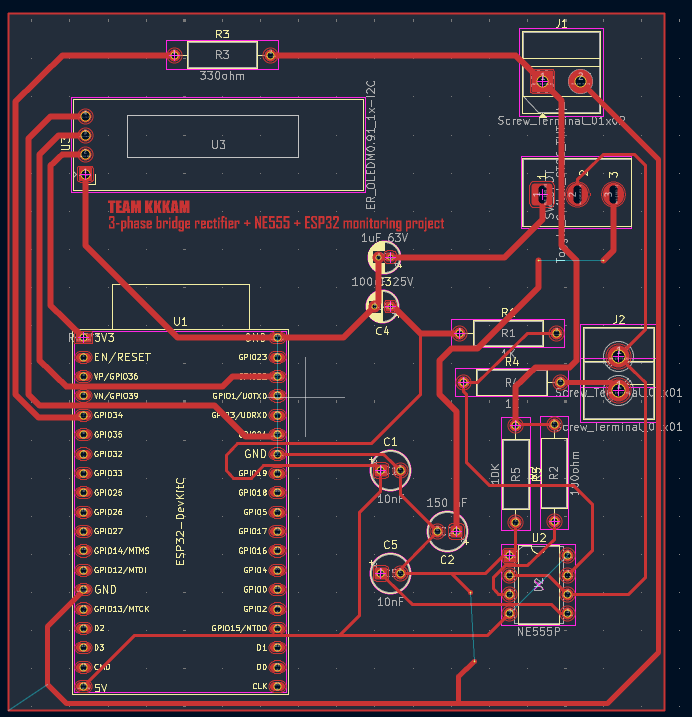
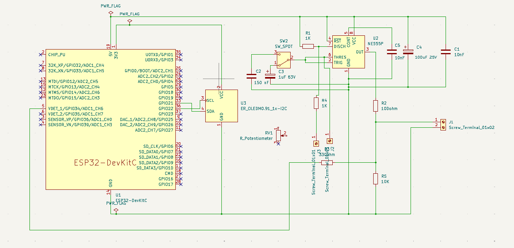
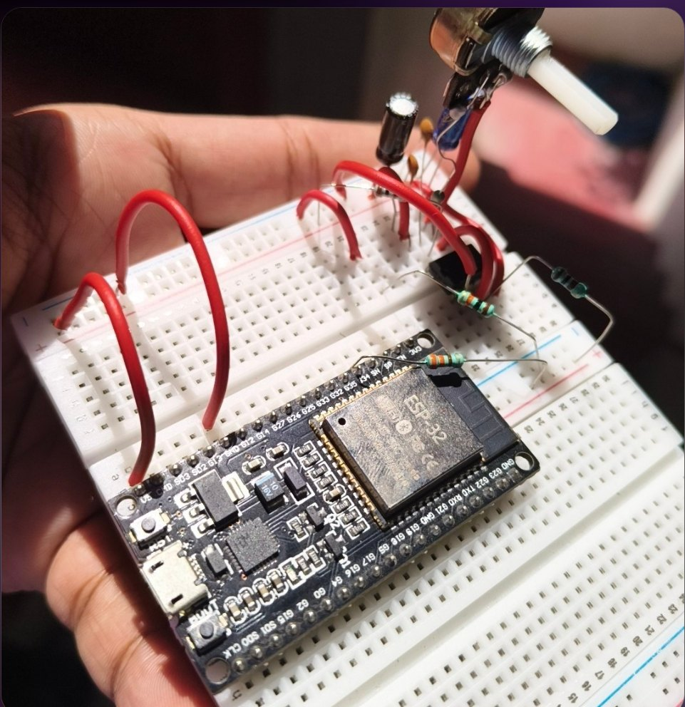
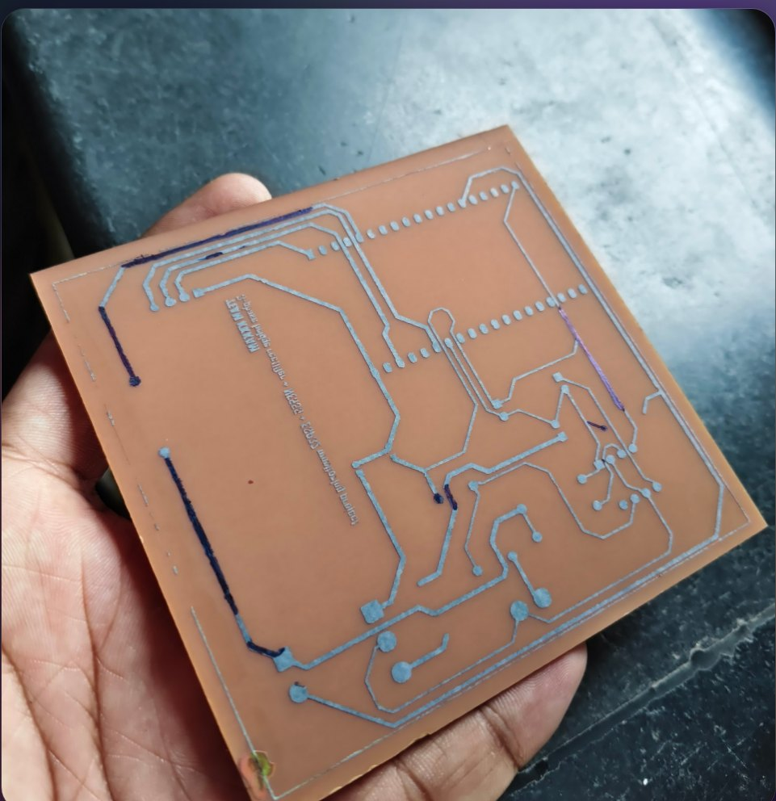
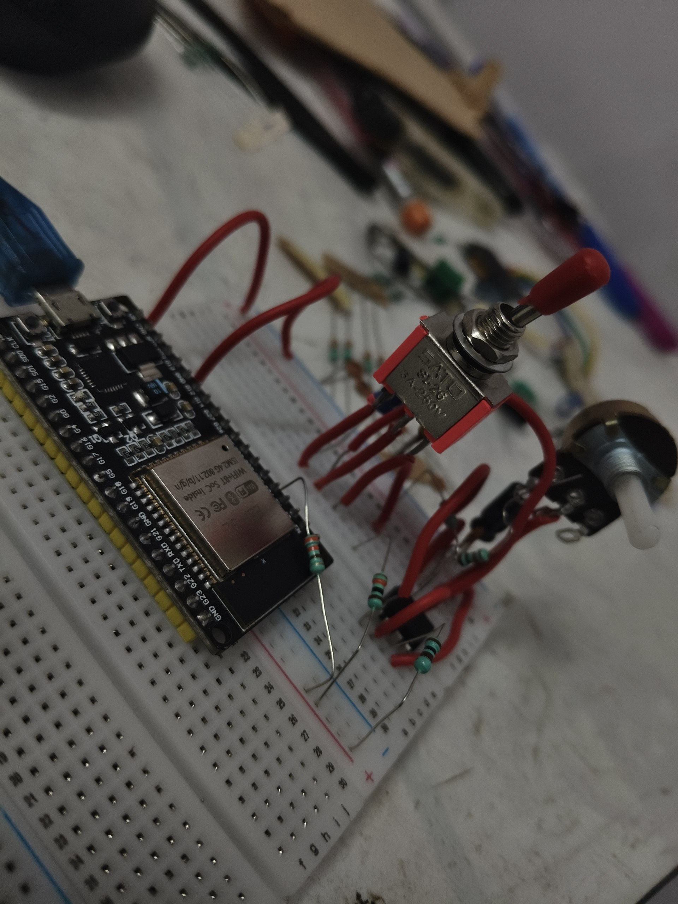

# PWM Signal Generator & Analyzer

**A dual-range NE555 PWM generator paired with an ESP32 frequency counter, built on a custom single-sided KiCad PCB.**

**Case study:** [PWM Signal Generator & Analyzer](https://kaushikfunde.vercel.app/#/work/pwm-analyzer)



## Overview

This project combines a classic 555-timer oscillator with a modern microcontroller measurement stage. The NE555 runs as an astable multivibrator and produces a 5 V square wave. An SPDT switch selects between two timing capacitors, and a 10 kΩ potentiometer tunes the frequency within the selected range. The ESP32 counts the incoming pulses over a one-second window and displays the frequency and range status on a 128×64 OLED.

The board was designed in KiCad, fabricated as a single-sided PCB, and assembled by hand as a third-semester course project.

**Status:** Prototype — the PCB has been fabricated and partially assembled; final electrical validation is pending.

## Features

- Dual-range NE555 astable oscillator: 150 nF and 1 µF timing capacitors
- Continuous frequency tuning with an external 10 kΩ potentiometer
- ESP32 hardware-interrupt frequency counter with a 1-second gate
- 128×64 I²C OLED readout using the U8g2 library
- 115200 baud serial telemetry for debugging
- Screw-terminal connections for the generator output and external controls
- Custom single-sided PCB designed and routed in KiCad

## At a glance

| | |
|---|---|
| **Generator** | NE555P astable multivibrator, 5 V |
| **Ranges** | 150 nF / 1 µF timing capacitors |
| **Controller** | ESP32-WROOM-32 DevKitC |
| **Display** | 128×64 I²C OLED (SH1106) |
| **Input** | GPIO34, rising-edge interrupt |
| **PCB** | Single-sided, KiCad 10, hand-etched |
| **Firmware** | Arduino C++ |
| **License** | MIT |

## System overview

```text
        ┌──────────────────┐   5 V square wave   ┌──────────────────┐
        │  NE555 astable   │ ──────────────────► │  conditioning /  │
        │  range + tuning  │                     │  GPIO34 input    │
        └────────┬─────────┘                     └────────┬─────────┘
                 │                                        │
          C2 / C3 range                            ESP32-WROOM-32
          RV1 tuning                                     │
                                                 I2C OLED 128×64
```

The NE555 timing network is formed by R1, R4, RV1, and the selected capacitor. SW2 selects C2 (150 nF) for the higher range or C3 (1 µF) for the lower range. The generator output is available at the J1 screw terminal and is also conditioned before reaching the ESP32 input.

The firmware uses an interrupt on GPIO34 to count rising edges. Every second it copies the pulse count safely with interrupts disabled, computes the frequency, reads the range-sense pin, and refreshes the OLED.

## Hardware

| Ref | Part | Value / notes |
|---|---|---|
| U1 | ESP32 DevKitC | ESP32-WROOM-32 |
| U2 | NE555P | Astable oscillator |
| U3 | OLED module | 128×64, I²C, SH1106-compatible |
| R1 | Resistor | 1 kΩ |
| R2 | Resistor | 100 Ω, output series |
| R3 | Resistor | 330 Ω, series to GPIO34 |
| R4 | Resistor | 1 kΩ |
| R5 | Resistor | 10 kΩ, input load |
| RV1 | Potentiometer | 10 kΩ, external |
| C1 | Capacitor | 10 nF |
| C2 | Capacitor | 150 nF |
| C3 | Capacitor | 1 µF, 63 V |
| C4 | Capacitor | 100 µF, 25 V |
| C5 | Capacitor | 10 nF |
| SW2 | Switch | SPDT range selector |
| J1 | Terminal block | 2-pin generator output |

### Pinout

| ESP32 pin | Connection | Purpose |
|---|---|---|
| GPIO34 | Conditioned NE555 output | Pulse input (interrupt) |
| GPIO27 | Range-sense line | Range select (see note below) |
| GPIO21 | OLED SDA | I²C data |
| GPIO22 | OLED SCL | I²C clock |
| 5V / GND | NE555 VCC / GND | Supply and common ground |

## Firmware

The sketch is at [`firmware/minorprojectv1.0/minorprojectv1.0.ino`](firmware/minorprojectv1.0/minorprojectv1.0.ino).

### Build and upload

1. Install the **ESP32 board package** in Arduino IDE.
2. Install the **U8g2** library via Library Manager.
3. Open `firmware/minorprojectv1.0/minorprojectv1.0.ino`.
4. Select **ESP32 Dev Module** and the correct serial port.
5. Upload, then open the Serial Monitor at **115200 baud**.

The ESP32 is powered over USB, while the NE555 stage is powered from an external 5 V supply. Both sections share a common ground.

### Current behavior

- Counts rising edges on GPIO34 for one second.
- Prints `Frequency: <value> Hz` to the serial monitor.
- Displays the frequency and the state of GPIO27 on the OLED.
- The range pin uses `INPUT_PULLUP`: HIGH reports `A (1 uF)`, LOW reports `B (150 nF)`.

## Design files

Open [`hardware/MinorProject.kicad_pro`](hardware/MinorProject.kicad_pro) with **KiCad 10** or newer.

- [`hardware/MinorProject.kicad_sch`](hardware/MinorProject.kicad_sch) — schematic
- [`hardware/MinorProject.kicad_pcb`](hardware/MinorProject.kicad_pcb) — PCB layout
- [`hardware/MinorProject-Schematic.pdf`](hardware/MinorProject-Schematic.pdf) — exported schematic
- [`hardware/fabrication/`](hardware/fabrication/) — copper, mask, paste, silkscreen, and edge-cut plots
- [`hardware/DPDTswitch.pretty/`](hardware/DPDTswitch.pretty/) — custom switch footprint



## Build photos

| Breadboard prototype | Fabricated PCB |
| --- | --- |
|  |  |

| Range switch detail | KiCad PCB render |
| --- | --- |
|  |  |

## Repository layout

```text
.
├── firmware/
│   └── minorprojectv1.0/
│       └── minorprojectv1.0.ino
├── hardware/
│   ├── fabrication/
│   ├── DPDTswitch.pretty/
│   ├── MinorProject.kicad_pro
│   ├── MinorProject.kicad_sch
│   ├── MinorProject.kicad_pcb
│   ├── MinorProject-Schematic.pdf
│   └── fp-lib-table
├── images/
├── LICENSE
└── README.md
```

## Design notes and next revision

These are the known gaps in the current prototype, documented for the next board revision:

- **Input protection.** The PCB revision here uses R2 (100 Ω), R3 (330 Ω), and R5 (10 kΩ). This limits current but does not divide the 5 V output down to 3.3 V at GPIO34. Add the 6.8 kΩ / 10 kΩ divider specified in the project report (≈2.97 V) or a proper level shifter before connecting the ESP32.
- **Range sense.** GPIO27 is reserved for range detection, but it is not routed on the current PCB. The firmware's internal pull-up therefore reports Range A. The next revision should wire the second pole of the selector switch to GPIO27.
- **Measurement.** The current firmware measures frequency only. Duty-cycle and period measurement via CHANGE-edge interrupts are the next firmware step.
- **Validation.** Complete assembly and run the test plan: power-on, range switching, frequency tuning, divider voltage, no-signal handling, external output, and sustained stability.

## Author

Built by **Kaushik Funde** — electronics engineering student at G. H. Raisoni College of Engineering, Nagpur.

[Portfolio](https://kaushikfunde.vercel.app/) · [GitHub](https://github.com/Kaushikfunde) · [LinkedIn](https://www.linkedin.com/in/kaushik-funde-239925373/)

## License

Released under the [MIT License](LICENSE).

Third-party components — including the Arduino ESP32 core, U8g2, and KiCad libraries — remain under their own licenses.
